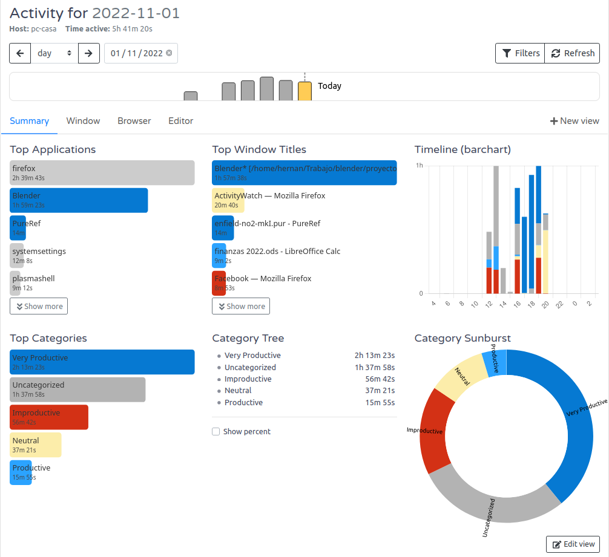
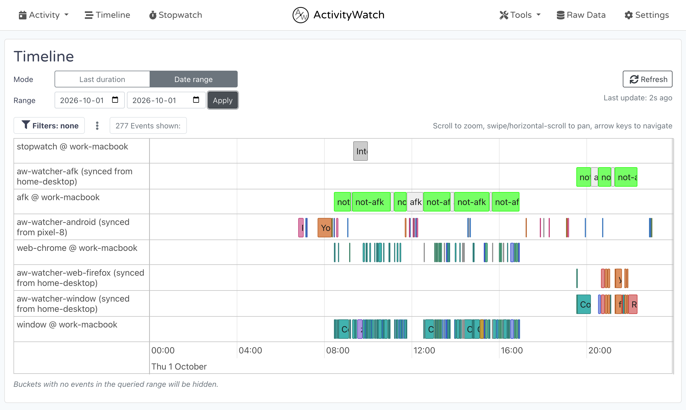

# ActivityWatch for Understanding Recorded Time and Attention

A browser left open during lunch can occupy a long window event without representing continuous active use.
ActivityWatch Tracker combines collected activity with inactivity signals so you can examine how a day was recorded before interpreting its totals.

[](https://activitywatch-tracker.github.io/ActivityWatch/)

## Read active time against recorded window time

Choose a short interval you remember clearly, then compare the window timeline with the AFK timeline.
The following example assumes these intervals have already been classified as active or AFK:

| Interval | Recorded foreground application | Time retained after an active-period filter |
| --- | --- | --- |
| 09:00 to 09:10 | Code editor, not AFK | 10 minutes |
| 09:10 to 09:20 | Browser, not AFK | 10 minutes |
| 09:20 to 09:35 | Browser, AFK | 0 minutes |

The window records cover 35 minutes, while the active-period intersection covers 20 minutes.
That difference follows from the chosen filter; it does not mean the browser watcher necessarily failed.
Keyboard and mouse inactivity also need interpretation when the task involves reading or watching a presentation.

Use a remembered session to check:

- Whether the relevant watcher was running.
- Whether the selected device and date match the session.
- Whether AFK filtering matches the question being asked.
- Whether the displayed categories reflect the actual applications.

## Trace each signal to its watcher

ActivityWatch stores events in buckets, normally separated by watcher and host.
The server stores and retrieves events; watchers collect them. The [architecture guide](https://docs.activitywatch.net/en/latest/architecture.html) explains that division.

The [watcher reference](https://docs.activitywatch.net/en/latest/watchers.html) describes window and AFK collection, plus browser and editor extensions.
The ActivityWatch web watcher adds browser-tab information; a window watcher and a browser watcher observe different aspects of the same session.
Avoid adding their durations together as though they were separate blocks of elapsed time.

Wakapi's heartbeat fixtures provide a comparison of ingestion and retrieval:

- [Create heartbeats.bru](testing/wakapi_api_tests/Heartbeats/Create%20heartbeats.bru) submits editor activity records.
- [Get heartbeats.bru](testing/wakapi_api_tests/Heartbeats/Get%20heartbeats.bru) retrieves records for a date.
- [Create heartbeats (non-matching).bru](testing/wakapi_api_tests/Heartbeats/Create%20heartbeats%20%28non-matching%29.bru) expects an unmatched endpoint to return 404.
- [Get heartbeats (readonly key).bru](testing/wakapi_api_tests/Heartbeats/Get%20heartbeats%20%28readonly%20key%29.bru) checks retrieval with a read-only key.

Their [count_duplicates_by_user.sql](scripts/count_duplicates_by_user.sql) groups duplicate heartbeat records by user and event fields.
It illustrates a separate data-quality concern from the normal overlap between two different watchers.



For a focused desktop question, an original ActivityWatch query can calculate active seconds in one application.
Replace YOURHOST with the actual window and AFK bucket suffixes, and replace Code with the recorded application value.
The query uses documented [event transformations](https://docs.activitywatch.net/en/latest/api/python.html#module-aw_transform):

```text
windows = query_bucket("aw-watcher-window_YOURHOST");
active = filter_keyvals(query_bucket("aw-watcher-afk_YOURHOST"), "status", ["not-afk"]);
selected = filter_keyvals(windows, "app", ["Code"]);
RETURN = sum_durations(filter_period_intersect(selected, active));
```

The result is a number of seconds within the query's selected time range.
It answers a narrower question than the full dashboard, whose settings may include additional activity signals.

## Keep the reporting period explicit

A local calendar day and a UTC date are different boundaries.
ActivityWatch's [data model](https://docs.activitywatch.net/en/latest/buckets-and-events.html) uses UTC timestamps and durations in seconds.
Choose the intended timezone before comparing a daily dashboard with an API result.

Wakapi supplies several useful period comparisons:

- [Get summary (today).bru](testing/wakapi_api_tests/Summary/Get%20summary%20%28today%29.bru) requests the current day.
- [Get summary (week).bru](testing/wakapi_api_tests/Summary/Get%20summary%20%28week%29.bru) requests a week-based start.
- [Get summary (last 7 days).bru](testing/wakapi_api_tests/Summary/Get%20summary%20%28last%207%20days%29.bru) uses a rolling-period name.
- [Get summary (range).bru](testing/wakapi_api_tests/Summary/Get%20summary%20%28range%29.bru) provides explicit endpoints.
- [Get summary (parse tz).bru](testing/wakapi_api_tests/Summary/Get%20summary%20%28parse%20tz%29.bru) tests timestamps containing an offset.
- [Get summary (default tz).bru](testing/wakapi_api_tests/Summary/Get%20summary%20%28default%20tz%29.bru) tests date-only input.

The Wakapi [date.go](utils/date.go) helpers calculate date boundaries, and [date_test.go](utils/date_test.go) exercises date-range splitting.
[interval.go](helpers/interval.go) resolves named periods; [interval_test.go](helpers/interval_test.go) checks range constraints.
[summary.go](helpers/summary.go) parses summary request parameters and filters.

For ActivityWatch automatic time tracking analysis, save the query above as active-code.txt after replacing its bucket values.
With aw-client installed and ActivityWatch running, execute it for an explicit local day using the documented [CLI](https://docs.activitywatch.net/en/latest/cli.html):

```powershell
aw-client query active-code.txt --start "2026-11-10" --stop "2026-11-11" --timezone "Asia/Tbilisi" --json
```

The timezone interprets the day boundaries; it does not change the meaning of stored UTC timestamps.
Keep the same period when comparing the returned seconds with the interface.

## Give recorded events useful labels

ActivityWatch categories group recorded activity into names that make a summary easier to read.
Start with a few recognizable groups, then inspect a sample of matched events before expanding the hierarchy.

In the category editor, a simple application-name rule could be:

```regex
^(Code|code|code[.]exe)$
```

Use the values actually present in your own events.
The [categorization documentation](https://docs.activitywatch.net/en/latest/features/categorization.html) describes matching application names and window titles, nested categories, and the No rule option.
A parent used only as a group can have No rule while its child categories perform the matching.

Wakapi's custom-mapping fixtures demonstrate a comparable review cycle:
[2. Add custom mapping.bru](testing/wakapi_api_tests/Settings/Use%20Case-%20Custom%20Mappings/2.%20Add%20custom%20mapping.bru) adds a language mapping,
[3. Check summary.bru](testing/wakapi_api_tests/Settings/Use%20Case-%20Custom%20Mappings/3.%20Check%20summary.bru) checks the resulting label,
and [4. Remove custom mapping.bru](testing/wakapi_api_tests/Settings/Use%20Case-%20Custom%20Mappings/4.%20Remove%20custom%20mapping.bru) removes the mapping.
[Get summary (today, filtered).bru](testing/wakapi_api_tests/Summary/Get%20summary%20%28today,%20filtered%29.bru) requests a summary restricted by project and language.

A label change and a period filter affect different parts of a report.
When a total changes unexpectedly, check the selected interval, AFK treatment, and matching rules separately.



## Keep a reusable record of the analysis

As an open source time tracker, ActivityWatch keeps collected activity data under the user's control.
Its [export tools](https://docs.activitywatch.net/en/latest/features/exporting-data.html) support individual bucket exports and a complete JSON export.

For a comparison you may revisit, keep:

- The selected device and exact bucket IDs.
- The reporting dates and timezone.
- The query or category rules used.
- Whether AFK periods were excluded.
- The relevant application and watcher versions.
- A dated export when the underlying events must be preserved.

An export preserves observations, while a summary expresses a particular interpretation of them.
Keep both when later rule changes need to be distinguished from changes in collected activity.
Review the selected watchers when a workflow moves between devices or operating systems.

## Related Search Terms

ActivityWatch Tracker, ActivityWatch, activitywatch open source time tracker, activitywatch automatic time tracking, activitywatch web watcher, time-tracker, time-tracking, productivity, analytics, dashboard, quantified-self, afk, cross-platform, privacy, open-source
